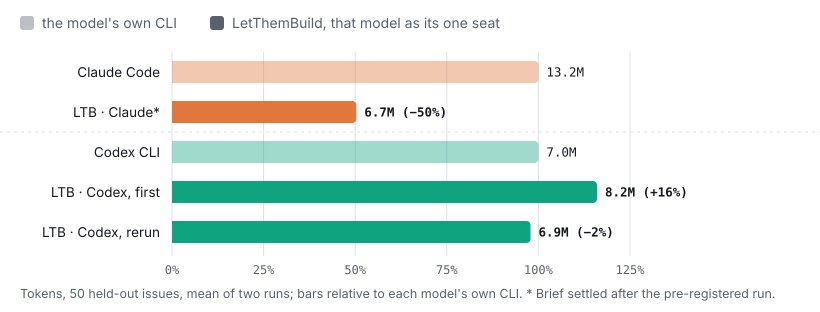
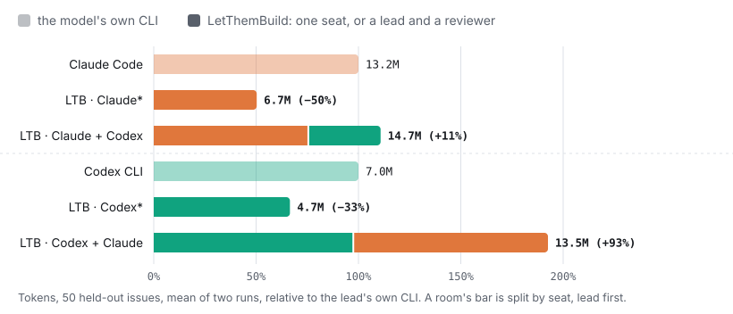
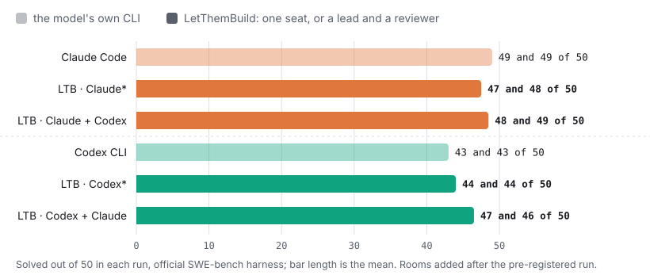
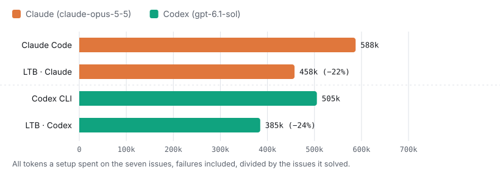

<sub>LETTHEMBUILD BENCHMARK · SWE-BENCH VERIFIED · NOVEMBER 2026 · 50 HELD-OUT ISSUES · PRE-REGISTERED</sub>

# What a coding CLI costs as a LetThemBuild seat

LetThemBuild runs a model's own command-line tool as a seat in a room. This benchmark measures what that costs:
the same model, on the same issues, run once in its own CLI and once as LetThemBuild's only seat, running that same
CLI underneath. The issues come from [SWE-bench Verified](https://www.swebench.com/), and every patch is graded by
the official SWE-bench harness against the project's own tests.

The held-out run below was pre-registered: the issues, the frozen versions, the isolation and the analysis were
published in [`v2/PREREGISTRATION.md`](v2/PREREGISTRATION.md) before the first run, on 50 issues LetThemBuild had
never been run on. Every patch, transcript, token count and contamination check is in [`v2/data/`](v2/data), and
[`v2/harness/`](v2/harness) is the exact runner.

This is a 50-issue sample, two runs per setup, not a leaderboard result.

> **Claude and Codex are complete. Gemini and Grok are still running** and are added here when they finish, under
> the same analysis. Their plans' usage limits pace them.

## What we found

- **Claude used 50% fewer tokens as a LetThemBuild seat than in Claude Code** (95% range −53% to −46%), fewer on
  all 50 issues, at about the same cost (−3%, range −8% to +2%). It solved 47.5 against 49 for Claude Code
  (difference −1.5, 95% interval −4 to 0): no detectable difference, only just.
- **Codex used 33% fewer tokens as a LetThemBuild seat than in the Codex CLI** (95% range −41% to −25%), fewer on
  46 of 50 issues, in less time. It solved 44 against 43 for the Codex CLI (difference +1, 95% interval −1 to +3):
  no detectable difference.
- **A reviewer costs tokens; for Codex it also solved more.** In a two-seat room with Codex leading and Claude
  reviewing, the room solved 46.5 against 43 for the Codex CLI alone (difference +3.5, 95% interval +0.5 to +7), the
  only detectable difference in issues solved here, for 93% more tokens and about five times the cost at list price
  ($12.03 against $2.44 per 50 issues). With Claude leading and Codex reviewing, it solved 48.5 against 49 for Claude
  Code, for 11% more tokens and about twice the cost ($16.99 against $8.04). See [Two seats](#two-seats-a-lead-and-a-reviewer).
- **Both one-seat setups are the ones LetThemBuild ships.** Each was settled after the pre-registered run, as
  [The brief](#the-brief) explains, and the pre-registered build's runs are published beside them.

## Tokens

<picture>
  <source media="(prefers-color-scheme: dark)" srcset="charts/heldout-50-tokens-dark.svg">
  
</picture>

Tokens are everything the model read and wrote: fresh input, cache reads, cache writes and output, as each tool
reports them.

## Issues solved

<picture>
  <source media="(prefers-color-scheme: dark)" srcset="charts/heldout-50-solved-dark.svg">
  
</picture>

## Every setup

| Setup | Model | Solved, run 1 · run 2 | Tokens, run 1 · run 2 | Mean | Change | 95% range | Fewer tokens on | Time per run |
|---|---|---:|---:|---:|---:|---|---:|---:|
| Claude Code alone | claude-opus-5-5 | 49 · 49 | 12.82M · 13.65M | 13.24M | | | | 30 min |
| **LetThemBuild · Claude*** | claude-opus-5-5 | **47 · 48** | **6.64M · 6.68M** | **6.66M** | **−49.7%** | −53.2% to −46.1% | 50 of 50 | 34 min |
| Codex CLI alone | gpt-6.1-sol | 43 · 43 | 7.21M · 6.86M | 7.03M | | | | 36 min |
| **LetThemBuild · Codex*** | gpt-6.1-sol | **44 · 44** | **4.68M · 4.68M** | **4.68M** | **−33.5%** | −41.1% to −25.2% | 46 of 50 | 32 min |

\* The brief LetThemBuild ships, settled after the pre-registered results were seen; see [The brief](#the-brief).
An issue's tokens are the mean of its two runs. The ranges come from resampling the 50 issues 10,000 times, keeping
each issue's runs together, with a fixed seed. Time per run is the wall-clock time for all 50 issues, mean of the
two runs.

### Issues solved, with intervals

| Model | Own CLI | LetThemBuild | Difference | 95% interval | Reading |
|---|---:|---:|---:|---|---|
| Claude* | 49 | 47.5 | −1.5 | −4 to 0 | no detectable difference |
| Codex* | 43 | 44 | +1 | −1 to +3 | no detectable difference |

Mean of the two runs. The interval is from the same resampling as the token ranges; a difference counts as
detectable only when its interval excludes zero, as pre-registered.

### Cost at list price

| Setup | Cost per run of 50, list price | Change | 95% range | Cheaper on |
|---|---:|---:|---|---:|
| Claude Code alone | $8.04 | | | |
| LetThemBuild · Claude* | $7.79 | −3.1% | −8.1% to +2.1% | 27 of 50 |
| Codex CLI alone | $2.44 | | | |
| LetThemBuild · Codex* | $2.56 | +5.2% | −5.5% to +17.4% | 22 of 50 |

Cost is not a pre-registered outcome; it is here because tokens alone hide it. Each model at its own list price, per
million tokens: claude-opus-5-5 input $4, cache read $0.20, cache write $5 (the five-minute cache), output $20;
gpt-6.1-sol input $2, cached input $0.10, output $10 (Codex reports no cache writes, and no call reached the
272k-token long-context tier). Claude Code writes to the one-hour cache, at $8 a million; at that price every Claude
setup costs more and the comparison barely moves.

The Codex seat's saving is in cached input, the cheapest kind: it read 3.80M cached tokens per run of 50 against
the Codex CLI's 6.34M. It took in more fresh input, 0.83M against 0.64M, at twenty times the cached price, and wrote
the same output (0.05M), so at list price the two cost about the same.

## Where the saving comes from

A LetThemBuild seat reads LetThemBuild's own brief with every call: how to check a change, how to report it to the
room. What that costs depends on what the CLI already carries.

- **Claude Code starts heavy.** As a seat it starts without the tools and instructions the room already covers,
  and that saving is larger than the brief.
- **The Codex CLI starts lean, so the brief has to be short.** Codex's own instructions already say how to work in
  a repository; the brief for Codex seats leaves that out and keeps to what only the room knows.
- **For both, the brief says each thing once.** It leaves out step-by-step narration the CLI does by itself, says
  how a change was checked once, and tries a test setup that will not run once before reporting it, so the seat
  neither writes more nor searches more than the CLI does alone.

## The brief

Each seat's brief was settled after the pre-registered run and tested on the same 50 held-out issues, two runs,
under the same harness, against the pre-registered runs of its own CLI. Because they were chosen after seeing
results, both are listed under Changes in the pre-registration, and every earlier setup's runs are published
unchanged.

**Claude.** The pre-registered build (8fa13171e) carried the brief as it was on 14 November 2026. Its Claude seat
used 35% fewer tokens than Claude Code (8.57M, range −39.6% to −30.4%) and solved 47 and 48, but cost 13% more at
list price (+7.3% to +18.4%): the saving was in cache reads, which are cheap, while the seat made 954 tool calls
over the two runs to Claude Code's 743, wrote 87% more text between steps and gave answers 60% longer, and output
and cache writes are the expensive tokens. The brief was then shortened (build a8cb60835), tried first on 15 issues
from the earlier run, and run on the held-out 50. Published as `letthembuild-claude-first-brief` (pre-registered)
and `letthembuild-claude` (shipped).

**Codex.** Codex seats get a short brief that leaves out what Codex's own instructions cover and names each of the
room's tools and rules once (build c5ae2f964). The short brief was tried on 15 issues from the earlier run and
tested on 25 other Verified issues that no setup had been tuned on; naming each tool and rule once was then tried on
another 15 issues from the earlier run, and the result run on the held-out 50. Against the full brief on the held-out
50 it used 32% fewer tokens (range −36.3% to −27.0%), fewer on 49 of 50 issues, and solved 44 against 42.5. Two
earlier setups are published unchanged: the pre-registered build's runs as `letthembuild-codex-first-run`, which
kept Codex's own sandbox on inside the harness's, so each command went to Codex's reviewer, a second model whose
tokens the seat's count did not include; and the full brief, run as LetThemBuild runs Codex, as
`letthembuild-codex-full-brief`. The 25-issue test is in [`v2/fresh-25/`](v2/fresh-25): 31% fewer tokens than the
Codex CLI, solved 20 against 21.5.

## Two seats: a lead and a reviewer

Added after the pre-registered run, on the same 50 held-out issues, two runs each, under the same harness, frozen
versions and models, with the build and briefs LetThemBuild ships (bbc845bba). One room has Claude leading and Codex
reviewing; the other has Codex leading and Claude reviewing. LetThemBuild runs a round as the lead's turn and then
the reviewer's; when the reviewer objects, the lead takes another round, and when the room is done the lead writes
a closing summary. Most runs took two rounds.

<picture>
  <source media="(prefers-color-scheme: dark)" srcset="charts/heldout-50-rooms-tokens-dark.svg">
  
</picture>

<picture>
  <source media="(prefers-color-scheme: dark)" srcset="charts/heldout-50-rooms-solved-dark.svg">
  
</picture>

| Room | Solved, run 1 · run 2 | Tokens, run 1 · run 2 | Mean | Against the lead's own CLI | 95% range | Solved difference | 95% interval | Time per run |
|---|---:|---:|---:|---:|---|---:|---|---:|
| Claude leads, Codex reviews | 48 · 49 | 14.85M · 14.48M | 14.67M | +10.8% | +1.2% to +21.4% | −0.5 | −1.5 to 0 | 83 min |
| Codex leads, Claude reviews | **47 · 46** | 13.54M · 13.55M | 13.54M | +92.6% | +70.9% to +115.5% | **+3.5** | **+0.5 to +7** | 80 min |

### Cost at list price

| Room | Cost per run of 50 | Against the lead's own CLI | 95% range | Against the lead as one seat | 95% range |
|---|---:|---:|---|---:|---|
| Claude leads, Codex reviews | $16.99 | +111% ($8.04) | +99% to +125% | +118% ($7.79) | +108% to +129% |
| Codex leads, Claude reviews | $12.03 | +394% ($2.44) | +352% to +439% | +370% ($2.56) | +326% to +416% |

Prices as in [Cost at list price](#cost-at-list-price) above, each seat at its own model's price. A room costs more
than its token count suggests when Claude is in it: most of a Claude seat's tokens are cache reads at $0.20 a
million, but most of its cost is cache writes ($5) and output ($20). As reviewer, Claude wrote 0.97M tokens to the
cache and 0.12M of output per run of 50, 86% of its $8.26. Codex
leading with Claude reviewing solved 3.5 more issues than the Codex CLI alone for $9.59 more per 50 issues, about
$2.74 per extra issue solved.

Against LetThemBuild with the lead as its one seat, the Claude-led room used 120% more tokens (range +107% to +134%)
and solved 48.5 against 47.5 (interval 0 to +3); the Codex-led room used 190% more (range +168% to +210%) and solved
46.5 against 44 (interval −0.5 to +6). Neither difference in issues solved is detectable.

Against the Codex CLI alone, the Codex-led room solved three issues in both runs that Codex alone solved in neither
(django-13512, django-14771, sympy-19783) and astropy-14369 in one run of two, and lost none. Against Claude Code,
the Claude-led room lost django-13807 in one run of two.

### Tokens in each round

Per issue, mean of the 100 runs of each room. "Per turn" is the mean over the runs that reached that turn; "per run"
counts a run that did not reach it as zero, so the "per run" columns add up to the room's tokens and cost per issue.
Cost is at list price, each seat at its own model's price.

**Claude leads, Codex reviews:** 293k tokens and $0.340 per issue; Claude 200k tokens and $0.291 (86% of the
cost), Codex 93k and $0.049. Last round reached: 1 in
8 runs, 2 in 84, 3 in 8.

| Turn | Seat | Runs | Tokens per turn | Per run | Output per turn | Cost per run |
|---|---|---:|---:|---:|---:|---:|
| Round 1, lead | Claude | 100 | 140k | 140k | 3,030 | $0.161 |
| Round 1, review | Codex | 100 | 71k | 71k | 379 | $0.036 |
| Round 2, lead | Claude | 92 | 40k | 37k | 1,011 | $0.050 |
| Round 2, review | Codex | 92 | 23k | 21k | 108 | $0.012 |
| Round 3, lead | Claude | 8 | 55k | 4k | 1,069 | $0.003 |
| Round 3, review | Codex | 8 | 24k | 2k | 111 | $0.001 |
| Closing summary | Claude | 94 | 20k | 18k | 819 | $0.077 |

**Codex leads, Claude reviews:** 271k tokens and $0.241 per issue; Codex 137k tokens and $0.076, Claude 134k and
$0.165 (69% of the cost). Last round reached: 1
in 5 runs, 2 in 79, 3 in 16.

| Turn | Seat | Runs | Tokens per turn | Per run | Output per turn | Cost per run |
|---|---|---:|---:|---:|---:|---:|
| Round 1, lead | Codex | 100 | 94k | 94k | 1,016 | $0.047 |
| Round 1, review | Claude | 100 | 96k | 96k | 1,679 | $0.123 |
| Round 2, lead | Codex | 95 | 24k | 23k | 128 | $0.009 |
| Round 2, review | Claude | 95 | 34k | 33k | 567 | $0.039 |
| Round 3, lead | Codex | 16 | 18k | 3k | 67 | $0.001 |
| Round 3, review | Claude | 16 | 33k | 5k | 473 | $0.004 |
| Closing summary | Codex | 98 | 17k | 17k | 119 | $0.019 |

- **The lead's first turn is the one-seat run.** Claude's first turn as lead (140k) is close to LetThemBuild · Claude
  alone (133k per issue), and Codex's (94k) matches LetThemBuild · Codex alone (94k). Everything after it is what
  the review adds: 153k per issue with Claude leading, 177k with Codex leading.
- **A review reads the work again.** The first review is the largest turn after the lead's: the reviewer reads the
  issue, the change and the checks for itself. Later rounds are smaller, since both seats carry their earlier turns.
- **Claude as reviewer costs as much as Codex as lead.** Claude's first review (96k) matches Codex's first turn
  (94k), and Claude writes more as reviewer than Codex does (1,679 output tokens a turn against 379), so the
  Codex-led room's extra tokens are mostly Claude's reviews.
- **The reviewer did not always agree.** 18 of the 200 runs ended with the reviewer still not agreeing after the
  last round; the lead's patch was graded as it stood, and 16 of those 18 were solved.

The per-turn figures come from each turn's usage line in `usage.jsonl`, matched to the turn in the room's
transcript, and add up to each run's total.

## How the held-out run was isolated

The same for every setup, as pre-registered:

- The workspace holds the repository at the issue's base commit and no later history.
- One macOS kernel profile: the run sees only its workspace, a fresh home folder, the CLIs' programs and the login
  keychain. The benchmark's own files do not exist for it.
- Network only through a proxy that admits the model providers, LetThemBuild's account service and PyPI.
- Every CLI's web search and fetch are off, and so are LetThemBuild's own web tools.

Versions: Claude Code 2.1.311, Codex CLI 0.167.0, claude-opus-5-5 and gpt-6.1-sol. One Apple M5 Mac, a 40-minute
limit per run; no run reached it. The CLI-alone runs and the pre-registered LetThemBuild build (8fa13171e) ran on
14–15 November 2026; LetThemBuild · Claude as shipped on 14 November (a8cb60835); LetThemBuild · Codex as shipped on
18 November (c5ae2f964), and the 25-issue test on 17–18 November with Codex CLI 0.169.0.

### Contamination checks

Every run carries a `contamination.json`: what reached it from outside the issue and its repository, what the
isolation refused, and whether the model named the benchmark.

- **Nothing outside the issue and its repository reached any of the 1,000 Claude and Codex runs**: the 700 one-seat
  held-out runs, the 200 two-seat runs and the 100 on the 25 other issues. No run is excluded.
- **Seven flags for attempts in the one-seat runs, none of which reached a run.** One Claude Code run tried
  github.com and was refused; in six runs the check flagged a link to an upstream pull request that sits in a
  comment in the project's own code. Reported, as pre-registered, not excluded.
- **Eight flags for attempts in the two-seat runs, none of which reached a run.** Six runs tried a site and were
  refused by the proxy; two flagged only the upstream link in the project's own code.
- **Claude Code's own web fetch was available to the Claude seat in the two-seat rooms.** It is off in every other
  setup. It was called five times in the 200 runs, and the proxy refused all five, so nothing reached a run; it is
  reported here because the pre-registration has every CLI's web tools off.
- **One flag for naming the benchmark, in seventeen runs of one issue,** matplotlib-23412: the word it matched was part of
  `test_patches.py`, the project's own test file, not the benchmark.

## Check it yourself

Print every figure above from the published data:

```bash
node v2/harness/verdict.mjs claude-code,claude-code-run2 letthembuild-claude,letthembuild-claude-run2
node v2/harness/verdict.mjs codex,codex-run2 letthembuild-codex,letthembuild-codex-run2
PRICE=list node v2/harness/verdict.mjs claude-code,claude-code-run2 letthembuild-claude,letthembuild-claude-run2
PRICE=list node v2/harness/verdict.mjs codex,codex-run2 letthembuild-codex,letthembuild-codex-run2
node v2/harness/charts.mjs
```

The two-seat rooms, against each lead's own CLI and against LetThemBuild with the lead as its one seat, and their
tokens and cost in each round (add `PRICE=list` to a verdict for its cost):

```bash
node v2/harness/verdict.mjs claude-code,claude-code-run2 letthembuild-claude-codex-review,letthembuild-claude-codex-review-run2
node v2/harness/verdict.mjs codex,codex-run2 letthembuild-codex-claude-review,letthembuild-codex-claude-review-run2
node v2/harness/verdict.mjs letthembuild-claude,letthembuild-claude-run2 letthembuild-claude-codex-review,letthembuild-claude-codex-review-run2
node v2/harness/verdict.mjs letthembuild-codex,letthembuild-codex-run2 letthembuild-codex-claude-review,letthembuild-codex-claude-review-run2
node v2/harness/rounds.mjs letthembuild-claude-codex-review,letthembuild-claude-codex-review-run2
node v2/harness/rounds.mjs letthembuild-codex-claude-review,letthembuild-codex-claude-review-run2
```

The earlier setups:

```bash
node v2/harness/verdict.mjs claude-code,claude-code-run2 letthembuild-claude-first-brief,letthembuild-claude-first-brief-run2
PRICE=claude node v2/harness/verdict.mjs claude-code,claude-code-run2 letthembuild-claude-first-brief,letthembuild-claude-first-brief-run2
node v2/harness/verdict.mjs letthembuild-codex-full-brief,letthembuild-codex-full-brief-run2 letthembuild-codex,letthembuild-codex-run2
node v2/harness/verdict.mjs codex,codex-run2 letthembuild-codex-first-run,letthembuild-codex-first-run-run2
DATA=v2/fresh-25/data node v2/harness/verdict.mjs codex,codex-run2 letthembuild-codex-short-brief,letthembuild-codex-short-brief-run2
```

Regrade the patches with the official harness (Docker, no model calls):

```bash
python -m venv .venv && .venv/bin/pip install swebench==5.0.2
.venv/bin/python -m swebench.harness.run_evaluation -d SWE-bench/SWE-bench_Verified -s test \
  -p v2/data/predictions/letthembuild-claude.jsonl -id regrade --max_workers 3
```

`v2/data/` has the same layout as `full-50/data/`, described at the end of this page, with a `contamination.json`
beside each run. Setups are `claude-code`, `codex`, `letthembuild-claude`, `letthembuild-codex`,
`letthembuild-claude-first-brief`, `letthembuild-codex-first-run`, `letthembuild-codex-full-brief`,
`letthembuild-claude-codex-review` (Claude leads, Codex reviews) and `letthembuild-codex-claude-review` (Codex leads,
Claude reviews), each with a
`-run2`. `v2/fresh-25/data/` has `codex` and `letthembuild-codex-short-brief`, likewise.

## What this does not show

- **Fifty issues, two runs each.** The ranges say how much runs vary; a solved difference of one or two issues is
  within that.
- **Two pairings of reviewers only.** The two-seat rooms were added after the pre-registered run and are one lead
  and one reviewer each, in one round limit; larger rooms, other pairings and other limits are not measured. The
  Codex-led room's gain in issues solved is one result among several comparisons, on 50 issues.
- **One machine, one week's models and CLIs.** Results move as they change; versions and dates are above.
- **Gemini and Grok are not here yet.** They are pre-registered and will be reported whatever their result.

---

## The first run: 50 issues the brief was tuned on

Before the held-out run we measured Claude and Codex on the other 50 issues of the same seeded draw, between 4 and 8
November 2026. LetThemBuild's brief was tuned on those issues, Claude Code ran with the plugins and connectors
installed on a working developer's Mac, and the runs were not isolated from the network. The held-out run above is
the one to judge by. The first run is kept as published, with its data in [`full-50/`](full-50).

> **Gemini and Grok results withdrawn (14 November 2026).** We also ran Gemini and Grok. Their figures are withdrawn
> while we run them again with web access off and the workspace kept apart from the benchmark's own files. Their
> runs stay in `full-50/data` for reference, but they are not part of the results in this section.

### What we found

- **Both models used fewer tokens inside LetThemBuild than in their own CLI.** Claude −55% and Codex −9%, over all
  50 issues and both runs.
- **They solved about as many issues.** Across the two runs: Claude 43.5 against 43.5 for Claude Code, Codex 41.5
  against 41 for the Codex CLI. With 50 issues that means no detectable difference, not proof of equal quality.
- **For Claude the saving is beyond run-to-run variation.** The 95% range is −59% to −51%, and LetThemBuild with
  Claude used fewer tokens than Claude Code on 49 of the 50 issues.
- **For Codex it is smaller and less certain.** Its range, −17% to +0.3%, comes close to no difference.

### Tokens for the 50 issues

<picture>
  <source media="(prefers-color-scheme: dark)" srcset="charts/full-50-tokens-dark.svg">
  
</picture>

Each model's own CLI sits directly above LetThemBuild running that model. Each pair is drawn against its own CLI; the labels
carry the totals. Tokens are everything
the model read and wrote: fresh input, cache reads, cache writes and output, as each tool reports them.

### Issues solved

<picture>
  <source media="(prefers-color-scheme: dark)" srcset="charts/full-50-solved-dark.svg">
  
</picture>

### Every setup

| Setup | Model | Solved, run 1 · run 2 | Tokens, run 1 · run 2 | Mean | Change | 95% range | Fewer tokens on |
|---|---|---:|---:|---:|---:|---|---:|
| Claude Code alone | claude-opus-5-5 | 45 · 42 | 17.72M · 14.46M | 16.09M | | | |
| **LetThemBuild · Claude** | claude-opus-5-5 | **43 · 44** | **7.39M · 7.04M** | **7.22M** | **−55.1%** | −59.4% to −50.5% | 49 of 50 |
| Codex CLI alone | gpt-6.1-sol | 42 · 40 | 15.10M · 14.05M | 14.57M | | | |
| **LetThemBuild · Codex** | gpt-6.1-sol | **42 · 41** | **12.73M · 13.88M** | **13.30M** | **−8.7%** | −16.8% to +0.3% | 33 of 50 |

An issue's tokens are the mean of its two runs. The range comes from resampling the 50 issues 10,000 times,
keeping each issue's runs together, with a fixed seed.

### By difficulty

| SWE-bench difficulty | Issues | Claude | Codex |
|---|---:|---:|---:|
| Under 15 minutes | 21 | −55.5% | −3.5% |
| 15 minutes – 1 hour | 25 | −54.8% | −11.1% |
| 1 – 4 hours | 4 | −55.5% | −11.8% |

Change in tokens from the model's own CLI to LetThemBuild with that model. Difficulty is SWE-bench Verified's own
label, not anything measured here. Only four issues carry the 1–4 hour label, too few to read much into on their
own.

### Where the saving comes from

A coding CLI sends its own instructions and the description of every tool it has with each model call, and a fix
takes several calls, so that fixed part is read again and again. For Claude Code it was most of what the model read.

LetThemBuild starts a seat with what the room's work needs. For Claude Code that means the file, search and shell
tools and LetThemBuild's own brief, without the tools the room already covers and without the plugins and
connectors installed on the machine. Claude Code on this Mac began each call with about 45k tokens before the issue
was read; the same CLI as a LetThemBuild seat began with about 16k. Each issue took about seven calls either
way (7.4 as a seat, 6.7 alone), so the saving is in what each call carries, not in doing less work.

That 45k is Claude Code as it was installed here, with this developer's plugins and connectors; a fresh install
starts nearer 32k. Scaling Claude Code's runs to that figure would put Claude's saving at about −40% rather than
−55%. That is our estimate, not a measured run.

For Codex the difference is small either way.

### How the test was run

#### The issues

We drew 100 issues from SWE-bench Verified with a fixed seed (`random.Random(20261023)` over the sorted instance
ids), then took the first 50 ordered by `sha256("letthembuild-swe-2026-11:" + id)`; `harness/select_tasks.py`
rebuilds both lists. The 50 span nine projects and all three difficulty bands:
[`full-50/data/tasks.txt`](full-50/data/tasks.txt).

#### The prompt, the same for every run

> Resolve the GitHub issue below in this repository, which is checked out at the commit where it was reported.
> Change the source code so the issue is fixed. You do not need to add or change tests: the fix will be checked
> with the project's own tests. Make the change; do not ask questions.
>
> `<issue>` … the issue text from SWE-bench … `</issue>`

#### Conditions

| Setup | What ran | Permissions |
|---|---|---|
| Claude Code alone | Claude Code 2.1.311, `claude -p`, with the settings, plugins and connectors installed on the test Mac | `--permission-mode auto` |
| Codex CLI alone | Codex CLI 0.165.0, `codex exec` | `--sandbox workspace-write` |
| LetThemBuild · Codex | LetThemBuild desktop 1.1.369 with brief 2026-11-05.3, `run` in a terminal; its one seat runs that model's CLI | `--permission auto` |
| LetThemBuild · Claude | LetThemBuild desktop, the build after 1.1.369: brief 2026-11-08.1 and the lean start for Claude Code seats (a setting, on by default) | `--permission auto` |

Inside LetThemBuild the seat is the same CLI, on the same subscription and the same model, as the setup it is
compared with; what differs is what LetThemBuild sends it and how it starts it. The rooms had one seat, no
reviewers and ranking off, and ran a single round. Every run started from the same checkout at the issue's base
commit with a 40-minute limit, on one Apple M5 Mac (24 GB, macOS 26.3), between 4 and 8 November 2026. A run that
reached the limit would have been graded as it stood; no Claude or Codex run did. A run a subscription's usage limit
cut short was discarded and run again once the limit had reset.

#### Measurement

- **Tokens:** each tool's own count. Claude Code's final `modelUsage`, the sum of Codex's per-turn `usage`, and
  LetThemBuild's per-call record of what its seat's CLI reported
  (`usage.jsonl`). All include cache reads.
- **Solved:** the official harness, `swebench` 5.0.2, `run_evaluation` against `SWE-bench/SWE-bench_Verified`, in
  Docker 29.1.3. A run's patch is everything it changed against the base commit, minus the tools' own folders.
  Reports: [`full-50/data/grades/`](full-50/data/grades), and `report.json` beside each run.
- **Time:** wall-clock seconds from start to exit.

### What this does not show

- **Fifty issues, two runs each.** Agentic runs vary from run to run; the ranges above say how much. Codex's
  difference is within that variation or close to it.
- **Claude's comparison depends on what is installed.** Claude Code was measured as it runs on a working
  developer's Mac. On a machine with nothing added the gap is smaller; our estimate is above.
- **Two LetThemBuild builds.** Claude's seat ran a newer build than Codex's, with a shorter brief and the lean
  start. Codex has not been rerun on it.
- **One seat only.** These are single-seat rooms. A room with reviewers reads the problem more than once and costs
  more tokens; that is a different measurement.
- **One machine, one week's models.** Results will move as models and tools change; versions and dates are above.

### Check it yourself

Regrade our patches: no model calls, just Docker and the harness.

```bash
python -m venv .venv && .venv/bin/pip install swebench==5.0.2
.venv/bin/python -m swebench.harness.run_evaluation -d SWE-bench/SWE-bench_Verified -s test \
  -p full-50/data/predictions/letthembuild-claude.jsonl -id regrade --max_workers 3
```

On an Apple-silicon Mac, pull the x86 images first, for example
`docker pull --platform linux/amd64 swebench/sweb.eval.x86_64.django_1776_django-13023:latest`.

Print every figure in the tables above, and redraw the charts:

```bash
node harness/verdict.mjs full-50 claude-code,claude-code-run2 letthembuild-claude,letthembuild-claude-run2
node harness/verdict.mjs full-50 codex,codex-run2 letthembuild-codex,letthembuild-codex-run2
node harness/charts-full.mjs
```

Run it again from scratch:

```bash
export BENCH_DIR=$PWD/bench && mkdir -p $BENCH_DIR
python harness/prepare.py                         # the 100 issues and a mirror of each repository
cp full-50/data/tasks.txt $BENCH_DIR/
node harness/run.mjs cc django__django-13023      # setups: cc | agy | codex | grok | ltb-claude | ltb-gemini | …
node harness/grade-full.mjs                       # grades whatever is in $BENCH_DIR/runs
```

The LetThemBuild setups need the LetThemBuild desktop app (`LTB_DESKTOP` points at it). Our runs used two
measurement hooks that change none of what the model is sent: one fixes the room for a single run, the other writes
each model call's usage to a file.

### What is in this repository

```
full-50/data/
  tasks.txt                      the 50 issues
  difficulty.json                SWE-bench Verified's difficulty label for each issue
  results.csv                    one row per run: setup, issue, tokens, solved, seconds
  predictions/<setup>.jsonl      the patches, in the harness's input format
  grades/<setup>.json            the issues each setup solved
  runs/<setup>/<issue>/
    prompt.txt                   what the setup was given
    patch.diff                   what it changed
    run.json                     time, exit, files changed, solved, tokens by model
    report.json                  the harness's report for that one patch
    transcript.jsonl             the tool's own event stream: messages, commands, results, usage
    usage.jsonl                  LetThemBuild only: each model call's tokens
data/                            the same layout for the first seven issues (below)
charts/                          the charts, light and dark
harness/                         select_tasks.py, prepare.py, run.mjs, grade.mjs, grade-full.mjs, charts.mjs,
                                 charts-full.mjs, export-public.mjs, verdict.mjs
```

Setups are `claude-code`, `codex` and `letthembuild-<model>`, each with a `-run2` for its second run. The
`gemini`, `grok`, `letthembuild-gemini` and `letthembuild-grok` folders hold the withdrawn runs. Transcripts are the tools' own streams with machine details removed: home-folder paths and email addresses
are replaced, and the parts that describe the machine rather than the run (app settings, other conversations,
installed plugins, connectors and commands, a listing of the home folder or of the shell's environment) are left
out. `harness/export-public.mjs` is exactly what did that.

### The first seven issues

Before the full run we published a first look: seven of the 50 issues, Claude and Codex, one run each, on
4 November 2026 with LetThemBuild 1.1.369 and brief 2026-11-05.1. It is kept here as published, with its data in
[`data/`](data). In that batch Claude Code alone had some commands refused that LetThemBuild's seat was allowed;
the 50-issue run above gives every setup the same freedom, and is the one to judge by.

#### Tokens per solved issue

<picture>
  <source media="(prefers-color-scheme: dark)" srcset="charts/tokens-per-solved-issue-dark.svg">
  
</picture>

Each model's own CLI sits directly above LetThemBuild running that model, with the difference in brackets. Tokens
are everything the model read and wrote: fresh input, cache reads, cache writes and output, as each tool reports
them.

#### Where the tokens went

<picture>
  <source media="(prefers-color-scheme: dark)" srcset="charts/tokens-solved-vs-not-dark.svg">
  
</picture>

#### Every setup

| Setup | Model | Issues solved | Tokens, 7 runs | Per solved issue | Median run | Time, 7 runs |
|---|---|---:|---:|---:|---:|---:|
| Claude Code alone | claude-opus-5-5 | 5 / 7 | 2.94M | 588k | 276k | 5 min 38 s |
| **LetThemBuild · Claude** | claude-opus-5-5 | **6 / 7** | **2.75M** | **458k (−22%)** | 392k | 7 min 17 s |
| Codex CLI alone | gpt-6.1-sol | 5 / 7 | 2.53M | 505k | 227k | 8 min 39 s |
| **LetThemBuild · Codex** | gpt-6.1-sol | **5 / 7** | **1.92M** | **385k (−24%)** | 243k | 7 min 46 s |

#### Every issue

<picture>
  <source media="(prefers-color-scheme: dark)" srcset="charts/every-issue-dark.svg">
  
</picture>

| Issue | SWE-bench difficulty | Claude Code | LTB · Claude | Codex CLI | LTB · Codex |
|---|---|---:|---:|---:|---:|
| [django-13023](data/runs/claude-code/django__django-13023) | < 15 min | ✅ 226k | ✅ 424k | ✅ 166k | ✅ 243k |
| [django-14315](data/runs/claude-code/django__django-14315) | < 15 min | ❌ 189k | ❌ 320k | ❌ 225k | ❌ 182k |
| [sympy-24539](data/runs/claude-code/sympy__sympy-24539) | < 15 min | ✅ 276k | ✅ 211k | ✅ 213k | ✅ 231k |
| [xarray-3305](data/runs/claude-code/pydata__xarray-3305) | 15 min – 1 h | ✅ 237k | ✅ 387k | ✅ 416k | ✅ 259k |
| [matplotlib-20826](data/runs/claude-code/matplotlib__matplotlib-20826) | 15 min – 1 h | ✅ 661k | ✅ 406k | ✅ 285k | ✅ 319k |
| [scikit-learn-14710](data/runs/claude-code/scikit-learn__scikit-learn-14710) | 15 min – 1 h | ✅ 341k | ✅ 392k | ✅ 227k | ✅ 220k |
| [sympy-14248](data/runs/claude-code/sympy__sympy-14248) | 1 – 4 h | ❌ 1,008k | ✅ 604k | ❌ 993k | ❌ 471k |

✅ solved, ❌ not solved, by the official harness. The links open Claude Code's run; every other setup's patch and transcript is under `data/runs/<setup>/` with the same name.

Why the pattern? Every LetThemBuild turn carries the same standing brief: how to work, how to check a change, how to
report. On a one-line fix that is a fixed cost you can see (django-13023: 424k against 226k). On a long problem it
pays for itself. The brief asks the model to prove a change with the cheapest check that settles it, using the
tests and environment the project already has, and to say plainly what it could not check. That keeps a hard issue
from turning into a long search.

## Next

- Gemini and Grok on the held-out 50, as pre-registered.
- Rooms: the same issues with a second and third model reviewing the first, on the isolated harness, to show what a
  second opinion costs and what it catches.

---

LetThemBuild is made by GPULogy AI LLC · [letthembuild.com](https://letthembuild.com)
