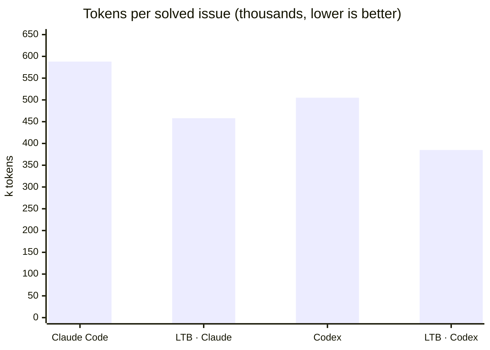

# Same model, fewer tokens per fix: LetThemBuild on SWE-bench Verified

*First results, 7 issues · November 2026 · data, transcripts and scripts in this repository*

Does running a model inside LetThemBuild cost you more tokens than running it in its own command-line tool? We put the
question to the benchmark everyone in coding agents knows, [SWE-bench Verified](https://www.swebench.com/): real
GitHub issues from real Python projects, each checked by the project's own tests. We graded every patch with the
official SWE-bench harness. Every patch, every transcript and every token count is in this repository, so you
can check our numbers rather than take our word for them.

This is the first batch, seven issues. The full run (50 issues, nine setups including Gemini, Grok and a two-model
room) follows, and this page will be updated with it.

## The short answer

With one model as its only seat, LetThemBuild **solved as many issues or more, for fewer tokens per solved issue**,
than that model's own CLI.

| Setup | Issues solved | Tokens, all 7 runs | Tokens per solved issue |
|---|---:|---:|---:|
| Claude Code alone (Claude Opus 5.5) | 5 / 7 | 2.94M | 588k |
| **LetThemBuild, Claude Opus 5.5 as the only seat** | **6 / 7** | **2.75M** | **458k (−22%)** |
| Codex alone (GPT-6.1 Sol) | 5 / 7 | 2.53M | 505k |
| **LetThemBuild, GPT-6.1 Sol as the only seat** | **5 / 7** | **1.92M** | **385k (−24%)** |

Tokens are everything the model read and wrote: fresh input, cache reads, cache writes and output, as each tool
reports them. "Tokens per solved issue" is all the tokens a setup spent, failures included, divided by the issues
it solved, which is what a fix actually costs you.



## Where the difference comes from

The totals hide the most interesting part, so here is every run:

| Issue | Difficulty | Claude Code | LTB · Claude | Codex | LTB · Codex |
|---|---|---:|---:|---:|---:|
| django-13023 | < 15 min | ✅ 226k | ✅ 424k | ✅ 166k | ✅ 243k |
| django-14315 | < 15 min | ❌ 189k | ❌ 320k | ❌ 225k | ❌ 182k |
| sympy-24539 | < 15 min | ✅ 276k | ✅ 211k | ✅ 213k | ✅ 231k |
| xarray-3305 | 15 min – 1 h | ✅ 237k | ✅ 387k | ✅ 416k | ✅ 259k |
| matplotlib-20826 | 15 min – 1 h | ✅ 661k | ✅ 406k | ✅ 285k | ✅ 319k |
| scikit-learn-14710 | 15 min – 1 h | ✅ 341k | ✅ 392k | ✅ 227k | ✅ 220k |
| sympy-14248 | 1 – 4 h | ❌ 1,008k | ✅ 604k | ❌ 993k | ❌ 471k |

(✅ solved, ❌ not solved, by the official harness; difficulty is SWE-bench Verified's own estimate.)

Three things stand out.

- **On the hard issue the difference is largest.** On sympy-14248, the one rated 1–4 hours, both CLIs on their own
  kept going past a million tokens and still did not fix it. Inside LetThemBuild, Claude fixed it with 604k, and
  GPT-6.1 Sol stopped at 471k: not fixed either, but at less than half the cost of the failed attempt alone.
- **On a short fix LetThemBuild costs a little more.** Every LetThemBuild turn carries the same standing brief (how
  to work, how to check a change, how to report), and on a one-line fix that fixed cost shows: django-13023 took
  424k inside LetThemBuild against 226k in Claude Code. The median run is higher inside LetThemBuild for both models
  (392k vs 276k for Claude, 243k vs 227k for GPT-6.1 Sol).
- **That brief pays for itself where it matters.** It asks the model to prove a change with the cheapest check that
  settles it, using the tests and environment the project already has, and to say plainly what it could not check.
  On long problems that is the difference between a focused fix and a long search.

So the honest summary: a few more tokens on the easy ones, far fewer where a fix is hard, fewer per fix overall,
and one more issue solved with Claude.

## How we ran it

**The issues.** We drew 100 issues from SWE-bench Verified with a fixed seed (`random.Random(20261023)` over the
sorted instance ids), then took the first 50 ordered by `sha256("letthembuild-swe-2026-11:" + id)`.
`harness/select_tasks.py` rebuilds both lists. For this first batch we took seven of those 50, spanning six
projects and all three difficulty bands: [`data/tasks.txt`](data/tasks.txt).

**The setups.** Each setup worked on the same checkout, at the commit where the issue was reported, with the same
prompt ([`data/runs/*/*/prompt.txt`](data/runs)): the issue text and an instruction to fix it in the source,
without needing to write tests.

| Setup | What ran | Model | Permissions |
|---|---|---|---|
| Claude Code alone | Claude Code 2.1.311, `claude -p` | `claude-opus-5-5` | edits accepted; read, search, git-inspect and Python/pytest commands allowed; anything else refused |
| Codex alone | Codex CLI 0.165.0, `codex exec` | `gpt-6.1-sol` | `--sandbox workspace-write` |
| LetThemBuild · Claude | LetThemBuild desktop 1.1.369, brief 2026-11-05.1, `run` in a terminal; its one seat runs Claude Code | `claude-opus-5-5` | `--permission auto` |
| LetThemBuild · Codex | the same, its one seat runs the Codex CLI | `gpt-6.1-sol` | `--permission auto` |

Inside LetThemBuild the seat is the same CLI, on the same subscription and the same model, as the setup it is
compared with. What differs is what LetThemBuild sends it and how it runs the work. The rooms had one seat and no
reviewers, with ranking off, and ran a single round. Every run had a 40-minute limit (none reached it), on one
Apple M5 Mac (24 GB, macOS 26.3) on 4 November 2026.

**The tokens.** Each tool's own count: Claude Code's final `modelUsage`, the sum of Codex's per-turn `usage`, and
LetThemBuild's per-call record of what its seat's CLI reported (`usage.jsonl`). All include cache reads.

**The grading.** The official harness, `swebench` 5.0.2, `run_evaluation` against `SWE-bench/SWE-bench_Verified`,
in Docker 29.1.3. A run's patch is everything it changed against the base commit, minus the tools' own folders. The
harness's reports are in [`data/grades/`](data/grades).

## Check it yourself

Regrade our patches: no model calls, just Docker and the harness.

```bash
python -m venv .venv && .venv/bin/pip install swebench==5.0.2
.venv/bin/python -m swebench.harness.run_evaluation -d SWE-bench/SWE-bench_Verified -s test \
  -p data/predictions/letthembuild-claude.jsonl -id regrade --max_workers 3
```

On an Apple-silicon Mac, pull the x86 images first, for example
`docker pull --platform linux/amd64 swebench/sweb.eval.x86_64.django_1776_django-13023:latest`.

Run it again from scratch:

```bash
export BENCH_DIR=$PWD/bench && mkdir -p $BENCH_DIR
python harness/prepare.py                         # the 100 issues and a mirror of each repository
cp data/tasks.txt $BENCH_DIR/
node harness/run.mjs cc django__django-13023      # setups: cc | codex | ltb-claude | ltb-codex | …
node harness/grade.mjs cc tasks.txt               # grades whatever is in $BENCH_DIR/runs/cc
```

The LetThemBuild setups need the LetThemBuild desktop app (`LTB_DESKTOP` points at it). Our runs used two
measurement hooks that change none of what the model is sent: one fixes the room for a single run, the other writes
each model call's usage to a file.

## What is in this repository

```
data/
  tasks.txt                      the seven issues
  results.csv                    one row per run: setup, issue, tokens, solved, seconds
  predictions/<setup>.jsonl      the patches, in the harness's input format
  grades/<setup>.json            the harness's report for each setup
  runs/<setup>/<issue>/
    prompt.txt                   what the setup was given
    patch.diff                   what it changed
    run.json                     time, exit, files changed, solved, tokens by model
    transcript.jsonl             the tool's own event stream: messages, commands, results, usage
    usage.jsonl                  LetThemBuild only: each model call's tokens
harness/                         select_tasks.py, prepare.py, run.mjs, grade.mjs, export-public.mjs
```

Transcripts are the tools' own streams with machine details removed: home-folder paths and email addresses are
replaced, and the parts that describe the machine rather than the run (app settings, other conversations,
installed plugins and connectors) are left out. `harness/export-public.mjs` is exactly what did that.

## Limits, plainly

- **Seven issues is a first look, not a verdict.** One run per setup per issue, and agentic runs vary from run to
  run, so a single issue's difference is noisy. The 50-issue run is the one to judge by.
- **Much of the saving is one issue.** Take sympy-14248 out and, on the remaining six, LetThemBuild with Claude used
  more tokens than Claude Code (2.14M vs 1.93M), while LetThemBuild with GPT-6.1 Sol still used fewer than Codex
  (1.45M vs 1.53M). We show it rather than leave it out, because hard issues are where a fix costs most.
- **Permissions were not identical.** Claude Code alone had 13 commands refused across its seven runs, seven of them
  on sympy-14248, where LetThemBuild's seat ran in auto mode. The full run gives every setup the same freedom.
- **One machine, one week's models.** Results will move as models and tools change; the date and versions are above.

## Next

The full run: all 50 issues, and Gemini 4 Argon High (Antigravity) and Grok 4.7 on their own and as LetThemBuild's
only seat, plus a room where Claude leads and GPT-6.1 Sol reviews, so you can see what a second opinion costs and
what it catches.

---

LetThemBuild is made by GPULogy AI LLC. [letthembuild.com](https://letthembuild.com)
