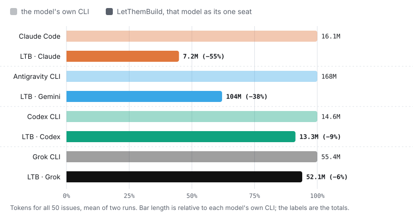
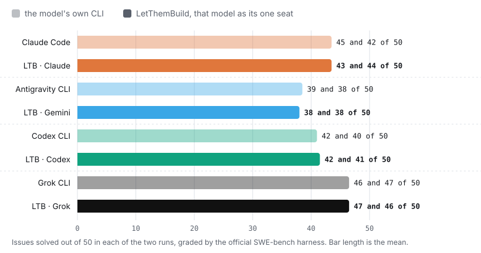
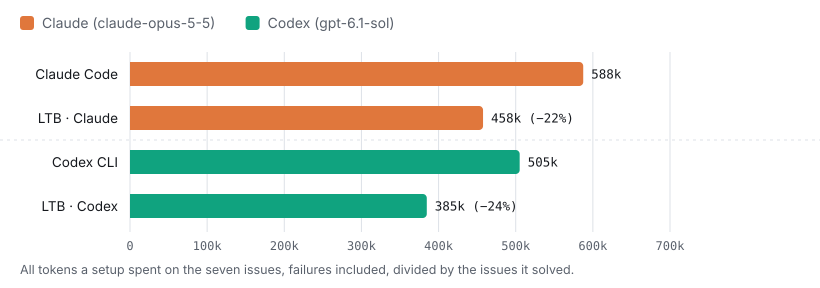
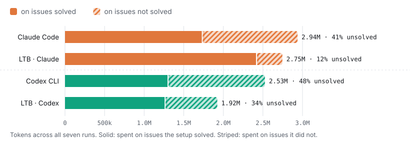
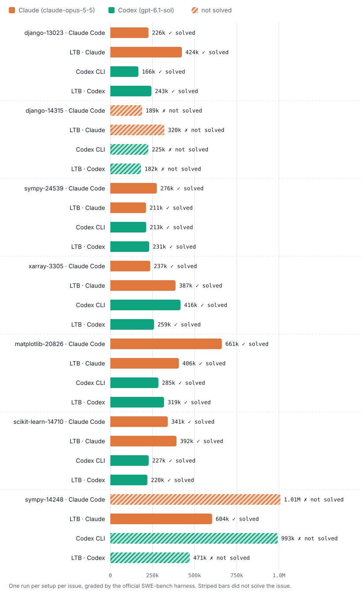

<sub>LETTHEMBUILD BENCHMARK · SWE-BENCH VERIFIED · NOVEMBER 2026 · 50 ISSUES · CLAUDE AND CODEX</sub>

# Same model, same fixes, fewer tokens: LetThemBuild against each model's own CLI

We gave Claude and Codex the same 50 real GitHub issues two ways: in the model's own command-line
tool, and in LetThemBuild with that model as the only seat, running the same CLI underneath. The issues come from
[SWE-bench Verified](https://www.swebench.com/), the benchmark coding agents are measured on, and every patch was
graded by the official SWE-bench harness against the project's own tests. Each setup ran every issue twice. This is
how many tokens each took and how many issues each solved. Every patch, transcript and token count is in this
repository, so you can check the numbers yourself.

> **Gemini and Grok results withdrawn (14 November 2026).** We also ran Gemini and Grok. Their figures are withdrawn
> while we run them again with web access off and the workspace kept apart from the benchmark's own files. Their
> runs stay in `full-50/data` for reference, but they are not part of the results below.

## What we found

- **Both models used fewer tokens inside LetThemBuild than in their own CLI.** Claude −55% and Codex −9%, over all
  50 issues and both runs.
- **They solved about as many issues.** Across the two runs: Claude 43.5 against 43.5 for Claude Code, Codex 41.5
  against 41 for the Codex CLI. With 50 issues that means no detectable difference, not proof of equal quality.
- **For Claude the saving is beyond run-to-run variation.** The 95% range is −59% to −51%, and LetThemBuild with
  Claude used fewer tokens than Claude Code on 49 of the 50 issues.
- **For Codex it is smaller and less certain.** Its range, −17% to +0.3%, comes close to no difference.

## Tokens for the 50 issues

<picture>
  <source media="(prefers-color-scheme: dark)" srcset="charts/full-50-tokens-dark.svg">
  
</picture>

Each model's own CLI sits directly above LetThemBuild running that model. Each pair is drawn against its own CLI; the labels
carry the totals. Tokens are everything
the model read and wrote: fresh input, cache reads, cache writes and output, as each tool reports them.

## Issues solved

<picture>
  <source media="(prefers-color-scheme: dark)" srcset="charts/full-50-solved-dark.svg">
  
</picture>

## Every setup

| Setup | Model | Solved, run 1 · run 2 | Tokens, run 1 · run 2 | Mean | Change | 95% range | Fewer tokens on |
|---|---|---:|---:|---:|---:|---|---:|
| Claude Code alone | claude-opus-5-5 | 45 · 42 | 17.72M · 14.46M | 16.09M | | | |
| **LetThemBuild · Claude** | claude-opus-5-5 | **43 · 44** | **7.39M · 7.04M** | **7.22M** | **−55.1%** | −59.4% to −50.5% | 49 of 50 |
| Codex CLI alone | gpt-6.1-sol | 42 · 40 | 15.10M · 14.05M | 14.57M | | | |
| **LetThemBuild · Codex** | gpt-6.1-sol | **42 · 41** | **12.73M · 13.88M** | **13.30M** | **−8.7%** | −16.8% to +0.3% | 33 of 50 |

An issue's tokens are the mean of its two runs. The range comes from resampling the 50 issues 10,000 times,
keeping each issue's runs together, with a fixed seed.

## By difficulty

| SWE-bench difficulty | Issues | Claude | Codex |
|---|---:|---:|---:|
| Under 15 minutes | 21 | −55.5% | −3.5% |
| 15 minutes – 1 hour | 25 | −54.8% | −11.1% |
| 1 – 4 hours | 4 | −55.5% | −11.8% |

Change in tokens from the model's own CLI to LetThemBuild with that model. Difficulty is SWE-bench Verified's own
label, not anything measured here. Only four issues carry the 1–4 hour label, too few to read much into on their
own.

## Where the saving comes from

A coding CLI sends its own instructions and the description of every tool it has with each model call, and a fix
takes several calls, so that fixed part is read again and again. For Claude Code it was most of what the model read.

LetThemBuild starts a seat with what the room's work needs. For Claude Code that means the file, search and shell
tools and LetThemBuild's own brief, without the tools the room already covers and without the plugins and
connectors installed on the machine. Claude Code on this Mac began each call with about 45k tokens before the issue
was read; the same CLI as a LetThemBuild seat began with about 16k. Each issue took about seven calls either
way (7.4 as a seat, 6.7 alone), so the saving is in what each call carries, not in doing less work.

That 45k is Claude Code as it was installed here, with this developer's plugins and connectors; a fresh install
starts nearer 32k. Scaling Claude Code's runs to that figure would put Claude's saving at about −40% rather than
−55%. That is our estimate, not a measured run.

For Codex the difference is small either way.

## How the test was run

### The issues

We drew 100 issues from SWE-bench Verified with a fixed seed (`random.Random(20261023)` over the sorted instance
ids), then took the first 50 ordered by `sha256("letthembuild-swe-2026-11:" + id)`; `harness/select_tasks.py`
rebuilds both lists. The 50 span nine projects and all three difficulty bands:
[`full-50/data/tasks.txt`](full-50/data/tasks.txt).

### The prompt, the same for every run

> Resolve the GitHub issue below in this repository, which is checked out at the commit where it was reported.
> Change the source code so the issue is fixed. You do not need to add or change tests: the fix will be checked
> with the project's own tests. Make the change; do not ask questions.
>
> `<issue>` … the issue text from SWE-bench … `</issue>`

### Conditions

| Setup | What ran | Permissions |
|---|---|---|
| Claude Code alone | Claude Code 2.1.311, `claude -p`, with the settings, plugins and connectors installed on the test Mac | `--permission-mode auto` |
| Codex CLI alone | Codex CLI 0.165.0, `codex exec` | `--sandbox workspace-write` |
| LetThemBuild · Codex | LetThemBuild desktop 1.1.369 with brief 2026-11-05.3, `run` in a terminal; its one seat runs that model's CLI | `--permission auto` |
| LetThemBuild · Claude | LetThemBuild desktop, the build after 1.1.369: brief 2026-11-08.1 and the lean start for Claude Code seats (a setting, on by default) | `--permission auto` |

Inside LetThemBuild the seat is the same CLI, on the same subscription and the same model, as the setup it is
compared with; what differs is what LetThemBuild sends it and how it starts it. The rooms had one seat, no
reviewers and ranking off, and ran a single round. Every run started from the same checkout at the issue's base
commit with a 40-minute limit, on one Apple M5 Mac (24 GB, macOS 26.3), between 4 and 8 November 2026. A run that
reached the limit would have been graded as it stood; no Claude or Codex run did. A run a subscription's usage limit
cut short was discarded and run again once the limit had reset.

### Measurement

- **Tokens:** each tool's own count. Claude Code's final `modelUsage`, the sum of Codex's per-turn `usage`, and
  LetThemBuild's per-call record of what its seat's CLI reported
  (`usage.jsonl`). All include cache reads.
- **Solved:** the official harness, `swebench` 5.0.2, `run_evaluation` against `SWE-bench/SWE-bench_Verified`, in
  Docker 29.1.3. A run's patch is everything it changed against the base commit, minus the tools' own folders.
  Reports: [`full-50/data/grades/`](full-50/data/grades), and `report.json` beside each run.
- **Time:** wall-clock seconds from start to exit.

## What this does not show

- **Fifty issues, two runs each.** Agentic runs vary from run to run; the ranges above say how much. Codex's
  difference is within that variation or close to it.
- **Claude's comparison depends on what is installed.** Claude Code was measured as it runs on a working
  developer's Mac. On a machine with nothing added the gap is smaller; our estimate is above.
- **Two LetThemBuild builds.** Claude's seat ran a newer build than Codex's, with a shorter brief and the lean
  start. Codex has not been rerun on it.
- **One seat only.** These are single-seat rooms. A room with reviewers reads the problem more than once and costs
  more tokens; that is a different measurement.
- **One machine, one week's models.** Results will move as models and tools change; versions and dates are above.

## Check it yourself

Regrade our patches: no model calls, just Docker and the harness.

```bash
python -m venv .venv && .venv/bin/pip install swebench==5.0.2
.venv/bin/python -m swebench.harness.run_evaluation -d SWE-bench/SWE-bench_Verified -s test \
  -p full-50/data/predictions/letthembuild-claude.jsonl -id regrade --max_workers 3
```

On an Apple-silicon Mac, pull the x86 images first, for example
`docker pull --platform linux/amd64 swebench/sweb.eval.x86_64.django_1776_django-13023:latest`.

Print every figure in the tables above, and redraw the charts:

```bash
node harness/verdict.mjs full-50 claude-code,claude-code-run2 letthembuild-claude,letthembuild-claude-run2
node harness/verdict.mjs full-50 codex,codex-run2 letthembuild-codex,letthembuild-codex-run2
node harness/charts-full.mjs
```

Run it again from scratch:

```bash
export BENCH_DIR=$PWD/bench && mkdir -p $BENCH_DIR
python harness/prepare.py                         # the 100 issues and a mirror of each repository
cp full-50/data/tasks.txt $BENCH_DIR/
node harness/run.mjs cc django__django-13023      # setups: cc | agy | codex | grok | ltb-claude | ltb-gemini | …
node harness/grade-full.mjs                       # grades whatever is in $BENCH_DIR/runs
```

The LetThemBuild setups need the LetThemBuild desktop app (`LTB_DESKTOP` points at it). Our runs used two
measurement hooks that change none of what the model is sent: one fixes the room for a single run, the other writes
each model call's usage to a file.

## What is in this repository

```
full-50/data/
  tasks.txt                      the 50 issues
  difficulty.json                SWE-bench Verified's difficulty label for each issue
  results.csv                    one row per run: setup, issue, tokens, solved, seconds
  predictions/<setup>.jsonl      the patches, in the harness's input format
  grades/<setup>.json            the issues each setup solved
  runs/<setup>/<issue>/
    prompt.txt                   what the setup was given
    patch.diff                   what it changed
    run.json                     time, exit, files changed, solved, tokens by model
    report.json                  the harness's report for that one patch
    transcript.jsonl             the tool's own event stream: messages, commands, results, usage
    usage.jsonl                  LetThemBuild only: each model call's tokens
data/                            the same layout for the first seven issues (below)
charts/                          the charts, light and dark
harness/                         select_tasks.py, prepare.py, run.mjs, grade.mjs, grade-full.mjs, charts.mjs,
                                 charts-full.mjs, export-public.mjs, verdict.mjs
```

Setups are `claude-code`, `codex` and `letthembuild-<model>`, each with a `-run2` for its second run. The
`gemini`, `grok`, `letthembuild-gemini` and `letthembuild-grok` folders hold the withdrawn runs. Transcripts are the tools' own streams with machine details removed: home-folder paths and email addresses
are replaced, and the parts that describe the machine rather than the run (app settings, other conversations,
installed plugins, connectors and commands, a listing of the home folder or of the shell's environment) are left
out. `harness/export-public.mjs` is exactly what did that.

## The first seven issues

Before the full run we published a first look: seven of the 50 issues, Claude and Codex, one run each, on
4 November 2026 with LetThemBuild 1.1.369 and brief 2026-11-05.1. It is kept here as published, with its data in
[`data/`](data). In that batch Claude Code alone had some commands refused that LetThemBuild's seat was allowed;
the 50-issue run above gives every setup the same freedom, and is the one to judge by.

### Tokens per solved issue

<picture>
  <source media="(prefers-color-scheme: dark)" srcset="charts/tokens-per-solved-issue-dark.svg">
  
</picture>

Each model's own CLI sits directly above LetThemBuild running that model, with the difference in brackets. Tokens
are everything the model read and wrote: fresh input, cache reads, cache writes and output, as each tool reports
them.

### Where the tokens went

<picture>
  <source media="(prefers-color-scheme: dark)" srcset="charts/tokens-solved-vs-not-dark.svg">
  
</picture>

### Every setup

| Setup | Model | Issues solved | Tokens, 7 runs | Per solved issue | Median run | Time, 7 runs |
|---|---|---:|---:|---:|---:|---:|
| Claude Code alone | claude-opus-5-5 | 5 / 7 | 2.94M | 588k | 276k | 5 min 38 s |
| **LetThemBuild · Claude** | claude-opus-5-5 | **6 / 7** | **2.75M** | **458k (−22%)** | 392k | 7 min 17 s |
| Codex CLI alone | gpt-6.1-sol | 5 / 7 | 2.53M | 505k | 227k | 8 min 39 s |
| **LetThemBuild · Codex** | gpt-6.1-sol | **5 / 7** | **1.92M** | **385k (−24%)** | 243k | 7 min 46 s |

### Every issue

<picture>
  <source media="(prefers-color-scheme: dark)" srcset="charts/every-issue-dark.svg">
  
</picture>

| Issue | SWE-bench difficulty | Claude Code | LTB · Claude | Codex CLI | LTB · Codex |
|---|---|---:|---:|---:|---:|
| [django-13023](data/runs/claude-code/django__django-13023) | < 15 min | ✅ 226k | ✅ 424k | ✅ 166k | ✅ 243k |
| [django-14315](data/runs/claude-code/django__django-14315) | < 15 min | ❌ 189k | ❌ 320k | ❌ 225k | ❌ 182k |
| [sympy-24539](data/runs/claude-code/sympy__sympy-24539) | < 15 min | ✅ 276k | ✅ 211k | ✅ 213k | ✅ 231k |
| [xarray-3305](data/runs/claude-code/pydata__xarray-3305) | 15 min – 1 h | ✅ 237k | ✅ 387k | ✅ 416k | ✅ 259k |
| [matplotlib-20826](data/runs/claude-code/matplotlib__matplotlib-20826) | 15 min – 1 h | ✅ 661k | ✅ 406k | ✅ 285k | ✅ 319k |
| [scikit-learn-14710](data/runs/claude-code/scikit-learn__scikit-learn-14710) | 15 min – 1 h | ✅ 341k | ✅ 392k | ✅ 227k | ✅ 220k |
| [sympy-14248](data/runs/claude-code/sympy__sympy-14248) | 1 – 4 h | ❌ 1,008k | ✅ 604k | ❌ 993k | ❌ 471k |

✅ solved, ❌ not solved, by the official harness. The links open Claude Code's run; every other setup's patch and transcript is under `data/runs/<setup>/` with the same name.

Why the pattern? Every LetThemBuild turn carries the same standing brief: how to work, how to check a change, how to
report. On a one-line fix that is a fixed cost you can see (django-13023: 424k against 226k). On a long problem it
pays for itself. The brief asks the model to prove a change with the cheapest check that settles it, using the
tests and environment the project already has, and to say plainly what it could not check. That keeps a hard issue
from turning into a long search.

## Next

Rooms: the same 50 issues with a second and third model reviewing the first, to show what a second opinion costs
and what it catches.

---

LetThemBuild is made by GPULogy AI LLC · [letthembuild.com](https://letthembuild.com)
