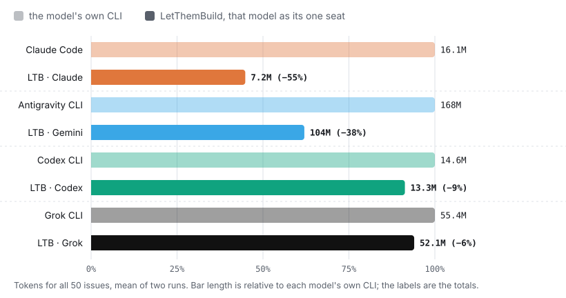
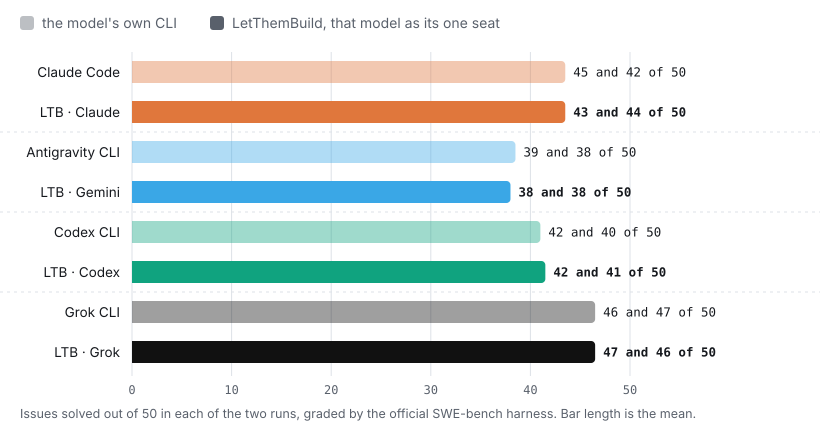

<sub>LETTHEMBUILD BENCHMARK · SWE-BENCH VERIFIED · NOVEMBER 2026 · 50 HELD-OUT ISSUES · PRE-REGISTERED</sub>

# What a coding CLI costs as a LetThemBuild seat

LetThemBuild runs a model's own command-line tool as a seat in a room. This benchmark measures what that costs:
the same model, on the same issues, run once in its own CLI and once as LetThemBuild's only seat, running that same
CLI underneath. The issues come from [SWE-bench Verified](https://www.swebench.com/), and every patch is graded by
the official SWE-bench harness against the project's own tests.

The held-out run below was pre-registered: the issues, the frozen versions, the isolation and the analysis were
published in [`v2/PREREGISTRATION.md`](v2/PREREGISTRATION.md) before the first run, on 50 issues LetThemBuild had
never been run on. Every patch, transcript, token count and contamination check is in [`v2/data/`](v2/data), and
[`v2/harness/`](v2/harness) is the exact runner.

This is a 50-issue sample, two runs per setup, not a leaderboard result.

> **Claude and Codex are complete. Gemini and Grok are still running** and are added here when they finish, under
> the same analysis. Their plans' usage limits pace them.

## What we found

- **Claude used 50% fewer tokens as a LetThemBuild seat than in Claude Code** (95% range −53% to −46%), fewer on
  all 50 issues, at about the same cost (−3%, range −8% to +2%). It solved 47.5 against 49 for Claude Code
  (difference −1.5, 95% interval −4 to 0): no detectable difference, only just. This is the brief LetThemBuild
  ships; it was settled after the pre-registered run, as [The brief](#the-brief) explains.
- **Codex used about as many tokens as a LetThemBuild seat as in the Codex CLI:** 2% fewer (95% range −11% to
  +7%), solving 42.5 against 43 (−0.5, interval −2.5 to +1). A first run of this setup showed 16% more; it kept
  Codex's own sandbox, which macOS cannot run inside the harness's, and was run again as LetThemBuild runs Codex
  under its own sandbox. See [Codex, run again](#codex-run-again).
- **With the brief LetThemBuild now gives it, Codex used 31% fewer tokens than the Codex CLI** (−42% to −20%), fewer
  on 22 of 25 issues, in less time, on 25 other Verified issues: solved 20 against 21.5 (−1.5, interval −3 to 0), no
  detectable difference, only just. This was added after the results above and is reported apart from them.

## Tokens

<picture>
  <source media="(prefers-color-scheme: dark)" srcset="charts/heldout-50-tokens-dark.svg">
  
</picture>

Tokens are everything the model read and wrote: fresh input, cache reads, cache writes and output, as each tool
reports them.

## Issues solved

<picture>
  <source media="(prefers-color-scheme: dark)" srcset="charts/heldout-50-solved-dark.svg">
  
</picture>

## Every setup

| Setup | Model | Solved, run 1 · run 2 | Tokens, run 1 · run 2 | Mean | Change | 95% range | Fewer tokens on | Time per run |
|---|---|---:|---:|---:|---:|---|---:|---:|
| Claude Code alone | claude-opus-5-5 | 49 · 49 | 12.82M · 13.65M | 13.24M | | | | 30 min |
| **LetThemBuild · Claude*** | claude-opus-5-5 | **47 · 48** | **6.64M · 6.68M** | **6.66M** | **−49.7%** | −53.2% to −46.1% | 50 of 50 | 34 min |
| Codex CLI alone | gpt-6.1-sol | 43 · 43 | 7.21M · 6.86M | 7.03M | | | | 36 min |
| LetThemBuild · Codex, first run† | gpt-6.1-sol | 44 · 44 | 8.14M · 8.17M | 8.16M | +16.0% | +4.3% to +28.7% | 12 of 50 | 67 min |
| **LetThemBuild · Codex, run again†** | gpt-6.1-sol | **42 · 43** | **6.83M · 6.75M** | **6.88M** | **−2.2%** | −10.8% to +6.6% | 20 of 50 | 44 min |

\* The brief LetThemBuild ships, settled after the pre-registered results were seen; the pre-registered build's
brief is reported in [The brief](#the-brief). † See [Codex, run again](#codex-run-again): one of its runs,
matplotlib-24627 in run 1, ended without a token count and is counted as unsolved and left out of that issue's token
mean, as pre-registered. An issue's tokens are the mean of its two runs.
The ranges come from resampling the 50 issues 10,000 times, keeping each issue's runs together, with a fixed seed.
Time per run is the wall-clock time for all 50 issues, mean of the two runs.

### Issues solved, with intervals

| Model | Own CLI | LetThemBuild | Difference | 95% interval | Reading |
|---|---:|---:|---:|---|---|
| Claude* | 49 | 47.5 | −1.5 | −4 to 0 | no detectable difference |
| Codex, first run† | 43 | 44 | +1 | 0 to +2.5 | no detectable difference |
| Codex, run again† | 43 | 42.5 | −0.5 | −2.5 to +1 | no detectable difference |

Mean of the two runs. The interval is from the same resampling as the token ranges; a difference counts as
detectable only when its interval excludes zero, as pre-registered.

### Cost, Claude only

| Setup | Cost per run of 50, list price | Change | 95% range | Cheaper on |
|---|---:|---:|---|---:|
| Claude Code alone | $8.04 | | | |
| LetThemBuild · Claude* | $7.79 | −3.1% | −8.1% to +2.1% | 27 of 50 |

Cost is not a pre-registered outcome; it is here because tokens alone hide it. Prices per million tokens for
claude-opus-5-5: input $4, cache read $0.20, cache write $5 (the five-minute cache), output $20. Claude Code
writes to the one-hour cache, at $8 a million; at that price every setup costs more and the comparison barely moves.

## Why the two models went different ways

A LetThemBuild seat reads LetThemBuild's own brief with every call: how to check a change, how to report it to the
room. What that costs depends on what the CLI already carries.

- **Claude Code starts heavy, so the seat saves.** As a seat it starts without the tools and instructions the room
  already covers, and that saving is larger than the brief.
- **The brief keeps to what only the room knows.** It leaves out the step-by-step narration Claude Code does by
  itself, says how a change was checked once, and tries a test setup that will not run once before reporting it,
  so the seat neither writes more nor searches more than Claude Code does.
- **The Codex CLI already starts lean, so a full brief only breaks even.** Run as LetThemBuild runs it, the Codex
  seat used about as many tokens as the Codex CLI alone with the full brief. The short brief removes what Codex's
  own instructions already cover, and with it the seat used 31% fewer.

## The brief

The pre-registered LetThemBuild build (8fa13171e) carried the brief as it was on 14 November 2026. On the held-out
50 its Claude seat used 35% fewer tokens than Claude Code (8.57M, range −39.6% to −30.4%) and solved 47 and 48, but
cost 13% more at list price (+7.3% to +18.4%): the saving was in cache reads, which are cheap, while the seat made
954 tool calls over the two runs to Claude Code's 743, wrote 87% more text between steps and gave answers 60%
longer, and output and cache writes are the expensive tokens.

The brief was then shortened (build a8cb60835), tested first on 15 issues from the earlier run, and run twice on
the same 50 held-out issues under the same harness, compared with the pre-registered Claude Code runs made earlier
the same day. That is the brief LetThemBuild ships and the one reported above. Because it was chosen after seeing the
pre-registered results, it is listed under Changes in the pre-registration, and the pre-registered build's runs are
published unchanged as `letthembuild-claude-first-brief`.

## Codex, run again

The harness's kernel profile stands in for every setup's sandbox, so the Codex CLI alone ran with its own sandbox
off. The first LetThemBuild · Codex runs instead kept Codex's own sandbox on. macOS cannot start one sandbox inside
another, so every command the seat ran asked for approval, and Codex sent each request to its reviewer, a second
model that writes its own session log. Those tokens were not in the seat's count.

The setup was run again on the same 50 issues, two runs, with one change: the seat runs as LetThemBuild runs Codex
under its own sandbox, where Codex's sandbox is off and no reviewer is called. Codex's own session logs were kept for
every run, so every session it started is counted; no run started a second one. The Codex-alone runs are the
pre-registered ones, unchanged. The change is listed in [`v2/PREREGISTRATION.md`](v2/PREREGISTRATION.md).

On one issue measured both ways outside these runs (django-13449), the first setup's seat counted 202k tokens while its reviewer spent another 172k;
run again, the same issue took 154k in all. So the first run's +16% understated what that setup cost.

## The short brief for Codex, on 25 other issues

LetThemBuild gives Claude Code seats a short brief that leaves out what Claude Code's own instructions cover. After
the rerun above, the same brief was tried for Codex on 15 issues of the first run, then tested on 25 Verified issues
that no setup had been tuned on, drawn with a fixed seed from the issues outside the first 100, two runs each, Codex
CLI 0.169.0 for both setups, under the same harness. Data in [`v2/fresh-25/`](v2/fresh-25).

| Setup | Solved, run 1 · run 2 | Tokens, run 1 · run 2 | Mean | Change | 95% range | Fewer tokens on | Time per run |
|---|---:|---:|---:|---:|---|---:|---:|
| Codex CLI alone | 21 · 22 | 3.24M · 3.05M | 3.15M | | | | 22 min |
| **LetThemBuild · Codex, short brief** | **19 · 21** | **2.14M · 2.19M** | **2.16M** | **−31.2%** | −41.6% to −20.1% | 22 of 25 | 16 min |

Issues solved: 20 against 21.5, a difference of −1.5 with a 95% interval of −3 to 0, so no detectable difference,
only just. The issues went differently in three places: two it solved in one of its two runs where the Codex CLI
solved both, and one the Codex CLI solved once and it did not. Output was about the same, 26k
tokens against 25k: the saving is in what each call reads. The short brief is LetThemBuild's brief for Codex seats
from its next release.

## How the held-out run was isolated

The same for every setup, as pre-registered:

- The workspace holds the repository at the issue's base commit and no later history.
- One macOS kernel profile: the run sees only its workspace, a fresh home folder, the CLIs' programs and the login
  keychain. The benchmark's own files do not exist for it.
- Network only through a proxy that admits the model providers, LetThemBuild's account service and PyPI.
- Every CLI's web search and fetch are off, and so are LetThemBuild's own web tools.

Versions: Claude Code 2.1.311, Codex CLI 0.167.0, LetThemBuild bench build 8fa13171e (with the shipped Claude brief, a8cb60835),
claude-opus-5-5 and gpt-6.1-sol. One Apple M5 Mac, 14–15 November 2026, a 40-minute limit per run; no run reached
it. The Codex rerun ran on 17–18 November on the same build with the one change described above, and the 25-issue
test on 17–18 November with Codex CLI 0.169.0. Within each model the CLI alone and LetThemBuild ran the same issue one after the other.

### Contamination checks

Every run carries a `contamination.json`: what reached it from outside the issue and its repository, what the
isolation refused, and whether the model named the benchmark.

- **Nothing outside the issue and its repository reached any of the 700 Claude and Codex runs**, the 600 held-out
  runs and the 100 on the 25 other issues. No run is excluded.
- **Five flags for attempts, none of which reached a run.** One Claude Code run tried github.com and was refused;
  in four runs the check flagged a link to an upstream pull request that sits in a comment in the project's own
  code. Reported, as pre-registered, not excluded.
- **One flag for naming the benchmark, in eleven runs of one issue,** matplotlib-23412: the word it matched was part of
  `test_patches.py`, the project's own test file, not the benchmark.

## Check it yourself

Print every figure above from the published data:

```bash
node v2/harness/verdict.mjs claude-code,claude-code-run2 letthembuild-claude,letthembuild-claude-run2
node v2/harness/verdict.mjs claude-code,claude-code-run2 letthembuild-claude-first-brief,letthembuild-claude-first-brief-run2
node v2/harness/verdict.mjs codex,codex-run2 letthembuild-codex,letthembuild-codex-run2
node v2/harness/verdict.mjs codex,codex-run2 letthembuild-codex-rerun,letthembuild-codex-rerun-run2
DATA=v2/fresh-25/data node v2/harness/verdict.mjs codex,codex-run2 letthembuild-codex-short-brief,letthembuild-codex-short-brief-run2
PRICE=claude node v2/harness/verdict.mjs claude-code,claude-code-run2 letthembuild-claude,letthembuild-claude-run2
PRICE=claude node v2/harness/verdict.mjs claude-code,claude-code-run2 letthembuild-claude-first-brief,letthembuild-claude-first-brief-run2
node v2/harness/charts.mjs
```

Regrade the patches with the official harness (Docker, no model calls):

```bash
python -m venv .venv && .venv/bin/pip install swebench==5.0.2
.venv/bin/python -m swebench.harness.run_evaluation -d SWE-bench/SWE-bench_Verified -s test \
  -p v2/data/predictions/letthembuild-claude.jsonl -id regrade --max_workers 3
```

`v2/data/` has the same layout as `full-50/data/`, described at the end of this page, with a `contamination.json`
beside each run. Setups are `claude-code`, `codex`, `letthembuild-claude`, `letthembuild-claude-first-brief`,
`letthembuild-codex` and `letthembuild-codex-rerun`, each with a `-run2`. `v2/fresh-25/data/` has `codex` and
`letthembuild-codex-short-brief`, likewise.

## What this does not show

- **Fifty issues, two runs each.** The ranges say how much runs vary; a solved difference of one or two issues is
  within that.
- **One seat only.** A room with reviewers reads the problem more than once and costs more; that is a different
  measurement.
- **One machine, one week's models and CLIs.** Results move as they change; versions and dates are above.
- **Gemini and Grok are not here yet.** They are pre-registered and will be reported whatever their result.

---

## The first run: 50 issues the brief was tuned on

Before the held-out run we measured Claude and Codex on the other 50 issues of the same seeded draw, between 4 and 8
November 2026. LetThemBuild's brief was tuned on those issues, Claude Code ran with the plugins and connectors
installed on a working developer's Mac, and the runs were not isolated from the network. The held-out run above is
the one to judge by. The first run is kept as published, with its data in [`full-50/`](full-50).

> **Gemini and Grok results withdrawn (14 November 2026).** We also ran Gemini and Grok. Their figures are withdrawn
> while we run them again with web access off and the workspace kept apart from the benchmark's own files. Their
> runs stay in `full-50/data` for reference, but they are not part of the results in this section.

### What we found

- **Both models used fewer tokens inside LetThemBuild than in their own CLI.** Claude −55% and Codex −9%, over all
  50 issues and both runs.
- **They solved about as many issues.** Across the two runs: Claude 43.5 against 43.5 for Claude Code, Codex 41.5
  against 41 for the Codex CLI. With 50 issues that means no detectable difference, not proof of equal quality.
- **For Claude the saving is beyond run-to-run variation.** The 95% range is −59% to −51%, and LetThemBuild with
  Claude used fewer tokens than Claude Code on 49 of the 50 issues.
- **For Codex it is smaller and less certain.** Its range, −17% to +0.3%, comes close to no difference.

### Tokens for the 50 issues

<picture>
  <source media="(prefers-color-scheme: dark)" srcset="charts/full-50-tokens-dark.svg">
  
</picture>

Each model's own CLI sits directly above LetThemBuild running that model. Each pair is drawn against its own CLI; the labels
carry the totals. Tokens are everything
the model read and wrote: fresh input, cache reads, cache writes and output, as each tool reports them.

### Issues solved

<picture>
  <source media="(prefers-color-scheme: dark)" srcset="charts/full-50-solved-dark.svg">
  
</picture>

### Every setup

| Setup | Model | Solved, run 1 · run 2 | Tokens, run 1 · run 2 | Mean | Change | 95% range | Fewer tokens on |
|---|---|---:|---:|---:|---:|---|---:|
| Claude Code alone | claude-opus-5-5 | 45 · 42 | 17.72M · 14.46M | 16.09M | | | |
| **LetThemBuild · Claude** | claude-opus-5-5 | **43 · 44** | **7.39M · 7.04M** | **7.22M** | **−55.1%** | −59.4% to −50.5% | 49 of 50 |
| Codex CLI alone | gpt-6.1-sol | 42 · 40 | 15.10M · 14.05M | 14.57M | | | |
| **LetThemBuild · Codex** | gpt-6.1-sol | **42 · 41** | **12.73M · 13.88M** | **13.30M** | **−8.7%** | −16.8% to +0.3% | 33 of 50 |

An issue's tokens are the mean of its two runs. The range comes from resampling the 50 issues 10,000 times,
keeping each issue's runs together, with a fixed seed.

### By difficulty

| SWE-bench difficulty | Issues | Claude | Codex |
|---|---:|---:|---:|
| Under 15 minutes | 21 | −55.5% | −3.5% |
| 15 minutes – 1 hour | 25 | −54.8% | −11.1% |
| 1 – 4 hours | 4 | −55.5% | −11.8% |

Change in tokens from the model's own CLI to LetThemBuild with that model. Difficulty is SWE-bench Verified's own
label, not anything measured here. Only four issues carry the 1–4 hour label, too few to read much into on their
own.

### Where the saving comes from

A coding CLI sends its own instructions and the description of every tool it has with each model call, and a fix
takes several calls, so that fixed part is read again and again. For Claude Code it was most of what the model read.

LetThemBuild starts a seat with what the room's work needs. For Claude Code that means the file, search and shell
tools and LetThemBuild's own brief, without the tools the room already covers and without the plugins and
connectors installed on the machine. Claude Code on this Mac began each call with about 45k tokens before the issue
was read; the same CLI as a LetThemBuild seat began with about 16k. Each issue took about seven calls either
way (7.4 as a seat, 6.7 alone), so the saving is in what each call carries, not in doing less work.

That 45k is Claude Code as it was installed here, with this developer's plugins and connectors; a fresh install
starts nearer 32k. Scaling Claude Code's runs to that figure would put Claude's saving at about −40% rather than
−55%. That is our estimate, not a measured run.

For Codex the difference is small either way.

### How the test was run

#### The issues

We drew 100 issues from SWE-bench Verified with a fixed seed (`random.Random(20261023)` over the sorted instance
ids), then took the first 50 ordered by `sha256("letthembuild-swe-2026-11:" + id)`; `harness/select_tasks.py`
rebuilds both lists. The 50 span nine projects and all three difficulty bands:
[`full-50/data/tasks.txt`](full-50/data/tasks.txt).

#### The prompt, the same for every run

> Resolve the GitHub issue below in this repository, which is checked out at the commit where it was reported.
> Change the source code so the issue is fixed. You do not need to add or change tests: the fix will be checked
> with the project's own tests. Make the change; do not ask questions.
>
> `<issue>` … the issue text from SWE-bench … `</issue>`

#### Conditions

| Setup | What ran | Permissions |
|---|---|---|
| Claude Code alone | Claude Code 2.1.311, `claude -p`, with the settings, plugins and connectors installed on the test Mac | `--permission-mode auto` |
| Codex CLI alone | Codex CLI 0.165.0, `codex exec` | `--sandbox workspace-write` |
| LetThemBuild · Codex | LetThemBuild desktop 1.1.369 with brief 2026-11-05.3, `run` in a terminal; its one seat runs that model's CLI | `--permission auto` |
| LetThemBuild · Claude | LetThemBuild desktop, the build after 1.1.369: brief 2026-11-08.1 and the lean start for Claude Code seats (a setting, on by default) | `--permission auto` |

Inside LetThemBuild the seat is the same CLI, on the same subscription and the same model, as the setup it is
compared with; what differs is what LetThemBuild sends it and how it starts it. The rooms had one seat, no
reviewers and ranking off, and ran a single round. Every run started from the same checkout at the issue's base
commit with a 40-minute limit, on one Apple M5 Mac (24 GB, macOS 26.3), between 4 and 8 November 2026. A run that
reached the limit would have been graded as it stood; no Claude or Codex run did. A run a subscription's usage limit
cut short was discarded and run again once the limit had reset.

#### Measurement

- **Tokens:** each tool's own count. Claude Code's final `modelUsage`, the sum of Codex's per-turn `usage`, and
  LetThemBuild's per-call record of what its seat's CLI reported
  (`usage.jsonl`). All include cache reads.
- **Solved:** the official harness, `swebench` 5.0.2, `run_evaluation` against `SWE-bench/SWE-bench_Verified`, in
  Docker 29.1.3. A run's patch is everything it changed against the base commit, minus the tools' own folders.
  Reports: [`full-50/data/grades/`](full-50/data/grades), and `report.json` beside each run.
- **Time:** wall-clock seconds from start to exit.

### What this does not show

- **Fifty issues, two runs each.** Agentic runs vary from run to run; the ranges above say how much. Codex's
  difference is within that variation or close to it.
- **Claude's comparison depends on what is installed.** Claude Code was measured as it runs on a working
  developer's Mac. On a machine with nothing added the gap is smaller; our estimate is above.
- **Two LetThemBuild builds.** Claude's seat ran a newer build than Codex's, with a shorter brief and the lean
  start. Codex has not been rerun on it.
- **One seat only.** These are single-seat rooms. A room with reviewers reads the problem more than once and costs
  more tokens; that is a different measurement.
- **One machine, one week's models.** Results will move as models and tools change; versions and dates are above.

### Check it yourself

Regrade our patches: no model calls, just Docker and the harness.

```bash
python -m venv .venv && .venv/bin/pip install swebench==5.0.2
.venv/bin/python -m swebench.harness.run_evaluation -d SWE-bench/SWE-bench_Verified -s test \
  -p full-50/data/predictions/letthembuild-claude.jsonl -id regrade --max_workers 3
```

On an Apple-silicon Mac, pull the x86 images first, for example
`docker pull --platform linux/amd64 swebench/sweb.eval.x86_64.django_1776_django-13023:latest`.

Print every figure in the tables above, and redraw the charts:

```bash
node harness/verdict.mjs full-50 claude-code,claude-code-run2 letthembuild-claude,letthembuild-claude-run2
node harness/verdict.mjs full-50 codex,codex-run2 letthembuild-codex,letthembuild-codex-run2
node harness/charts-full.mjs
```

Run it again from scratch:

```bash
export BENCH_DIR=$PWD/bench && mkdir -p $BENCH_DIR
python harness/prepare.py                         # the 100 issues and a mirror of each repository
cp full-50/data/tasks.txt $BENCH_DIR/
node harness/run.mjs cc django__django-13023      # setups: cc | agy | codex | grok | ltb-claude | ltb-gemini | …
node harness/grade-full.mjs                       # grades whatever is in $BENCH_DIR/runs
```

The LetThemBuild setups need the LetThemBuild desktop app (`LTB_DESKTOP` points at it). Our runs used two
measurement hooks that change none of what the model is sent: one fixes the room for a single run, the other writes
each model call's usage to a file.

### What is in this repository

```
full-50/data/
  tasks.txt                      the 50 issues
  difficulty.json                SWE-bench Verified's difficulty label for each issue
  results.csv                    one row per run: setup, issue, tokens, solved, seconds
  predictions/<setup>.jsonl      the patches, in the harness's input format
  grades/<setup>.json            the issues each setup solved
  runs/<setup>/<issue>/
    prompt.txt                   what the setup was given
    patch.diff                   what it changed
    run.json                     time, exit, files changed, solved, tokens by model
    report.json                  the harness's report for that one patch
    transcript.jsonl             the tool's own event stream: messages, commands, results, usage
    usage.jsonl                  LetThemBuild only: each model call's tokens
data/                            the same layout for the first seven issues (below)
charts/                          the charts, light and dark
harness/                         select_tasks.py, prepare.py, run.mjs, grade.mjs, grade-full.mjs, charts.mjs,
                                 charts-full.mjs, export-public.mjs, verdict.mjs
```

Setups are `claude-code`, `codex` and `letthembuild-<model>`, each with a `-run2` for its second run. The
`gemini`, `grok`, `letthembuild-gemini` and `letthembuild-grok` folders hold the withdrawn runs. Transcripts are the tools' own streams with machine details removed: home-folder paths and email addresses
are replaced, and the parts that describe the machine rather than the run (app settings, other conversations,
installed plugins, connectors and commands, a listing of the home folder or of the shell's environment) are left
out. `harness/export-public.mjs` is exactly what did that.

### The first seven issues

Before the full run we published a first look: seven of the 50 issues, Claude and Codex, one run each, on
4 November 2026 with LetThemBuild 1.1.369 and brief 2026-11-05.1. It is kept here as published, with its data in
[`data/`](data). In that batch Claude Code alone had some commands refused that LetThemBuild's seat was allowed;
the 50-issue run above gives every setup the same freedom, and is the one to judge by.

#### Tokens per solved issue

<picture>
  <source media="(prefers-color-scheme: dark)" srcset="charts/tokens-per-solved-issue-dark.svg">
  
</picture>

Each model's own CLI sits directly above LetThemBuild running that model, with the difference in brackets. Tokens
are everything the model read and wrote: fresh input, cache reads, cache writes and output, as each tool reports
them.

#### Where the tokens went

<picture>
  <source media="(prefers-color-scheme: dark)" srcset="charts/tokens-solved-vs-not-dark.svg">
  
</picture>

#### Every setup

| Setup | Model | Issues solved | Tokens, 7 runs | Per solved issue | Median run | Time, 7 runs |
|---|---|---:|---:|---:|---:|---:|
| Claude Code alone | claude-opus-5-5 | 5 / 7 | 2.94M | 588k | 276k | 5 min 38 s |
| **LetThemBuild · Claude** | claude-opus-5-5 | **6 / 7** | **2.75M** | **458k (−22%)** | 392k | 7 min 17 s |
| Codex CLI alone | gpt-6.1-sol | 5 / 7 | 2.53M | 505k | 227k | 8 min 39 s |
| **LetThemBuild · Codex** | gpt-6.1-sol | **5 / 7** | **1.92M** | **385k (−24%)** | 243k | 7 min 46 s |

#### Every issue

<picture>
  <source media="(prefers-color-scheme: dark)" srcset="charts/every-issue-dark.svg">
  
</picture>

| Issue | SWE-bench difficulty | Claude Code | LTB · Claude | Codex CLI | LTB · Codex |
|---|---|---:|---:|---:|---:|
| [django-13023](data/runs/claude-code/django__django-13023) | < 15 min | ✅ 226k | ✅ 424k | ✅ 166k | ✅ 243k |
| [django-14315](data/runs/claude-code/django__django-14315) | < 15 min | ❌ 189k | ❌ 320k | ❌ 225k | ❌ 182k |
| [sympy-24539](data/runs/claude-code/sympy__sympy-24539) | < 15 min | ✅ 276k | ✅ 211k | ✅ 213k | ✅ 231k |
| [xarray-3305](data/runs/claude-code/pydata__xarray-3305) | 15 min – 1 h | ✅ 237k | ✅ 387k | ✅ 416k | ✅ 259k |
| [matplotlib-20826](data/runs/claude-code/matplotlib__matplotlib-20826) | 15 min – 1 h | ✅ 661k | ✅ 406k | ✅ 285k | ✅ 319k |
| [scikit-learn-14710](data/runs/claude-code/scikit-learn__scikit-learn-14710) | 15 min – 1 h | ✅ 341k | ✅ 392k | ✅ 227k | ✅ 220k |
| [sympy-14248](data/runs/claude-code/sympy__sympy-14248) | 1 – 4 h | ❌ 1,008k | ✅ 604k | ❌ 993k | ❌ 471k |

✅ solved, ❌ not solved, by the official harness. The links open Claude Code's run; every other setup's patch and transcript is under `data/runs/<setup>/` with the same name.

Why the pattern? Every LetThemBuild turn carries the same standing brief: how to work, how to check a change, how to
report. On a one-line fix that is a fixed cost you can see (django-13023: 424k against 226k). On a long problem it
pays for itself. The brief asks the model to prove a change with the cheapest check that settles it, using the
tests and environment the project already has, and to say plainly what it could not check. That keeps a hard issue
from turning into a long search.

## Next

- Gemini and Grok on the held-out 50, as pre-registered.
- Rooms: the same issues with a second and third model reviewing the first, on the isolated harness, to show what a
  second opinion costs and what it catches.

---

LetThemBuild is made by GPULogy AI LLC · [letthembuild.com](https://letthembuild.com)
